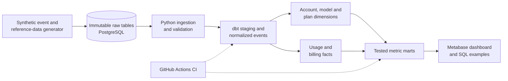

# API Usage & Unit Economics Warehouse

**A usage-based software business can only make dependable product, billing and margin decisions when request events are modeled at a declared grain, historical pricing is preserved, and usage, billing, cost and revenue metrics are reconciled against known cases.**

This repository is a fictional demonstration. It is not a replica of any company's internal systems, and all usage and economics are simulated.

| Label | Meaning |
|---|---|
| Planned | In the specification; not confirmed built |
| Implemented | Confirmed in the repository |
| Measured | Result from an actual run, with evidence |
| Modeled | Simulated business estimate, not an observed result |

---

## Contents

1. [Purpose and business questions](#1-purpose-and-business-questions)
2. [Architecture](#2-architecture)
3. [Technology stack](#3-technology-stack)
4. [Synthetic data strategy](#4-synthetic-data-strategy)
5. [Data model and table grain](#5-data-model-and-table-grain)
6. [Business metrics layer](#6-business-metrics-layer)
7. [Validation and acceptance tests](#7-validation-and-acceptance-tests)
8. [Implementation scope](#8-implementation-scope)
9. [Setup](#9-setup)
10. [Repository structure](#10-repository-structure)
11. [Results](#11-results)
12. [Limitations](#12-limitations)
13. [Design discussion topics](#13-design-discussion-topics)
14. [Documentation map](#14-documentation-map)

---

## 1. Purpose and business questions

The project shows how request-level API usage becomes governed billing and margin analytics. It answers:

- Which customers and models consume the most resources?
- What usage is billable under the correct historical price and plan?
- Which requests fail or arrive late, and how should they affect reported usage?
- What are estimated revenue, cost and gross margin by account, model and period?

## 2. Architecture

## 3. Technology stack

| Component | Role | Reason / trade-off |
|---|---|---|
| Python | Generate deterministic fixtures, ingest data, simulate late events and corrections | Required for reproducible source generation and validation |
| SQL + PostgreSQL | Store raw events, history, dimensional models and reconciliation fixtures | Keys, joins, grain and transactional corrections stay inspectable |
| dbt Core | Staging, incremental models, snapshots / effective-dated dimensions, tests, documentation | Core analytics-engineering layer; business logic stays reviewable in version control |
| Git + GitHub Actions | Version changes; run build and test checks on every proposed change | Reproducibility and quality gates |
| Metabase | Expose documented metrics; review account and model trends | Lightweight view over tested marts, not a replacement for correct models |

**Optional extensions** (deferred until raw-to-mart logic and reconciliation are correct): DuckDB for local analytical benchmarking, Docker for setup consistency, Airflow or Dagster only if scheduled runs become a goal.

## 4. Synthetic data strategy

Generated data covers accounts, API requests, model identifiers, timestamps, status codes, input/output units, pricing schedules, discounts and modeled provider costs.

Deliberately included cases:

- Known duplicate events
- Late-arriving events
- Missing dimensions
- Free-tier usage
- Price changes

## 5. Data model and table grain

The grain is declared before any transformation is written. The model names and grains below are starting contracts from the specification. Columns and keys are added only after their business meaning is documented.

| Model | Declared grain | Status |
|---|---|---|
| `fct_api_request` | One accepted source request event | Planned |
| `fct_usage_daily` | One account, model and usage date | Planned |
| `fct_billing_line` | One account, request/billable item and pricing version | Planned |
| `dim_account` | One account version | Planned |
| `dim_model` | One model version | Planned |
| `dim_plan` | One plan version | Planned |
| `dim_date` | One calendar date | Planned |

## 6. Business metrics layer

| Metric | Definition and calculation guardrail |
|---|---|
| Total requests | Distinct accepted request IDs in the selected period |
| Success / error rate | Successful or error requests divided by resolved requests; unresolved statuses must be defined |
| Billable usage | Units that meet documented billing rules |
| Estimated revenue | Billable units times the applicable historical price, adjusted for explicit credits and discounts |
| Estimated cost / gross margin | Modeled provider cost; estimated revenue minus estimated cost |
| Active accounts / usage growth | Accounts with qualifying usage; current-period usage versus a comparable period |

## 7. Validation and acceptance tests

All items are **Planned** acceptance criteria. None is reported as passing here.

- A successful request, failed request, duplicate, late event, price change and free-tier request are all represented as fixtures.
- Known request counts and a hand-calculated bill reconcile exactly.
- Re-running the same source input does not duplicate fact rows.
- Late events follow a documented incremental lookback policy.
- Invalid account references and invalid status values trigger visible test failures.
- Historical usage uses the applicable pricing version, not today's price, by default.

## 8. Implementation scope

| Stage | Build scope |
|---|---|
| MVP | Generate synthetic data; create raw tables; build 4–6 dbt models; implement 8–10 meaningful tests; publish three core metrics and one dashboard |
| Strong portfolio | Add historical pricing and plan snapshots, incremental processing, CI, a backfill/recovery demonstration, simulated ingestion alerts and a semantic-layer integration |

## 9. Limitations

Synthetic economics do not establish actual API pricing, customer behavior, revenue or cost savings. Measured warehouse behavior is kept separate from modeled business estimates.

## 10. Design discussion topics

| Topic | Where it is addressed |
|---|---|
| Event grain | [Section 5](#5-data-model-and-table-grain) |
| Idempotency and retry semantics | [Section 7](#7-validation-and-acceptance-tests) |
| Late-arriving events and incremental windows | [Section 7](#7-validation-and-acceptance-tests) |
| Effective-dated pricing | [Section 5](#5-data-model-and-table-grain) |
| Definition of billable usage | [Section 6](#6-business-metrics-layer) |
| Estimated versus observed margin | [Section 11](#11-results) |
