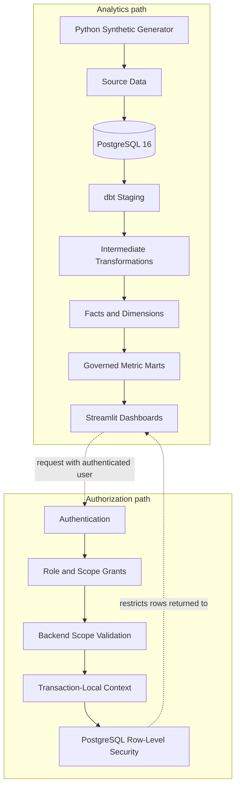
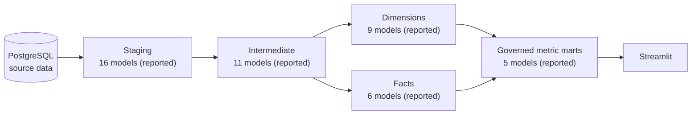

Multi-Tenant Education Analytics Platform
A reproducible Analytics Engineering and Data Governance MVP: inconsistent education-system data, transformed into trustworthy, tenant-isolated analytical insights.
Python synthetic data generation, PostgreSQL 16, dbt Core, governed metric contracts, PostgreSQL Row-Level Security and Streamlit dashboards.
> **Scope and status.** All education data is synthetic. This is an MVP demonstration, not a production-certified student information system, and it makes no FERPA, COPPA or other regulatory compliance claim. Items marked **[NEEDS INPUT]** are not yet verified against the repository. Verification figures are labeled as *reported* unless independently executed.
---
Contents
Title
Executive summary
At a glance
Why this project exists
Core capabilities
System architecture
End-to-end data lifecycle
Synthetic data engineering
Operational data model
Student identity resolution
Temporal data modeling
Attendance analytics
Analytics engineering and dbt
Governed metric catalog
Data quality and publication rules
Multi-tenant security architecture
Streamlit application experience
Technology stack
Quick start
Configuration reference
Available commands
Repository structure
Testing and verification
Architecture decisions
Known limitations
Roadmap
Documentation map
License and disclaimer
Closing
---
2. Executive summary
This project shows three things together:
Analytical data modeling: messy, multi-source education data becomes tested dimensional models with explicit grains and effective-dated history.
Metric governance: metric definitions live in governed dbt models with contracts, eligibility rules and publication thresholds, not in dashboard code.
Multi-tenant isolation: PostgreSQL Row-Level Security enforces tenant boundaries in the database, in addition to application-level authorization.
[NEEDS INPUT] One-sentence project thesis from the Master Technical Report.
3. At a glance
Dimension	Design
Data	Synthetic only
Generator	Python, deterministic
Database	PostgreSQL 16
Transformation	dbt Core
Metric governance	Governed metric contracts in dbt marts
Tenant isolation	PostgreSQL Row-Level Security
Serving layer	Streamlit, thin layer over governed metric marts
Maturity	MVP demonstration
Reported dbt layer counts (to be confirmed against `models/`):
Layer	Models
Staging	16
Intermediate	11
Dimensions	9
Facts	6
Governed metric marts	5
4. Why this project exists
[NEEDS INPUT] Problem statement from the Project Requirements. Left empty rather than inferred.
5. Core capabilities
> Status per capability (Implemented / Planned / Conceptual): **[NEEDS INPUT, take from Implementation Status]**.
Deterministic synthetic data generation with natural-key-derived UUIDv5 identifiers.
Tenant-scoped student identity resolution.
Effective-dated enrollment and membership history.
Late-arriving correction handling.
Source code normalization.
Attendance completeness against expected student-session pairs.
Data-quality issue classification.
Governed metric marts with publication rules.
Database-enforced tenant isolation with adversarial cross-tenant tests.
6. System architecture
6.1 Analytics path and authorization path

6.2 How the two paths interact
The analytics path produces governed data. The authorization path decides which rows of that data a given request may see. They meet at the serving layer: the application validates the requested scope, sets a transaction-local context, and PostgreSQL applies row-level policies to the queries that follow.
> **Conceptual.** This diagram follows the intended flow. **[NEEDS INPUT]** Confirm which relations carry RLS policies (source tables, marts, or both) against the Security Model and migrations.
7. End-to-end data lifecycle

```mermaid
flowchart LR
    A["Deterministic synthetic generation"] --> B["Source records<br/>with source codes"]
    B --> C["Normalize source codes"]
    C --> D["Resolve student identity<br/>(tenant-scoped)"]
    D --> E["Effective-dated enrollment<br/>and membership history"]
    E --> F["Apply late-arriving corrections"]
    F --> G["Expected student-session pairs"]
    G --> H["Attendance facts and completeness"]
    H --> I["Data-quality issue classification"]
    I --> J["Governed metrics and publication state"]
```

> **Conceptual ordering.** **[NEEDS INPUT]** Confirm the sequence against the Technical Architecture Document.
8. Synthetic data engineering
Topic	Design	Status
Determinism	Deterministic generation	[NEEDS INPUT] (seed handling)
Identifiers	Natural-key-derived UUIDv5	[NEEDS INPUT] (namespace, keys used)
Profiles	Integration profile and full profile	[NEEDS INPUT] (sizes, differences)
Injected data issues	[NEEDS INPUT]	[NEEDS INPUT]
9. Operational data model
[NEEDS INPUT] Core entities, keys and relationships from the Data Dictionary. Tenant-aware composite foreign keys are covered in section 16. No entity names are listed here until verified.
10. Student identity resolution
[NEEDS INPUT] Matching rules, tenant scoping, canonical identity definition, conflict handling. Reported verification: 10,000 canonical identities in the full-profile generator run (see section 23).
11. Temporal data modeling
Two time semantics are preserved and kept distinct:
Semantics	Meaning	Where used
Effective time	When a fact is true in the modeled world	[NEEDS INPUT]
Recorded time	When the system learned of or stored the fact	[NEEDS INPUT]
[NEEDS INPUT] Column names, effective-date interval conventions (inclusive/exclusive), and how late-arriving corrections are applied.
12. Attendance analytics
[NEEDS INPUT] Expected student-session pair definition, completeness rule, status codes and normalization. Reported: integration-profile attendance facts contain 2,141 rows.
13. Analytics engineering and dbt
13.1 Transformation architecture

Counts are taken from the reported project figures. No model names are shown because they have not been verified against the dbt project.
13.2 Layer purpose
Layer	Purpose	Count (reported)
Staging	[NEEDS INPUT]	16
Intermediate	[NEEDS INPUT]	11
Dimensions	[NEEDS INPUT]	9
Facts	[NEEDS INPUT]	6
Governed metric marts	[NEEDS INPUT]	5
13.3 Model inventory
[NEEDS INPUT] One table per layer with real model names. For facts, include verified grain and key. For dimensions, include relationships to facts.
Model	Layer	Grain	Key	Tests
[NEEDS INPUT]				
13.4 Metric contract ownership, tests, reconciliation, lineage
[NEEDS INPUT] Who owns each metric contract, the data-quality tests applied, reconciliation checks, publication thresholds, and `dbt docs` lineage.
14. Governed metric catalog
Metric definitions belong in governed analytical models, not in dashboard components. The dashboard reads published values and does not recompute them.
For each verified metric, document the following ([NEEDS INPUT] metric names and values from the Metric Dictionary):
Metric	Business definition	Population eligibility	Numerator	Denominator	Exclusions	Aggregation rules	Completeness requirement	Publication state
[NEEDS INPUT]								
15. Data quality and publication rules
Control	Description	Status
Data-quality issue classification	[NEEDS INPUT] (categories)	[NEEDS INPUT]
dbt tests	[NEEDS INPUT]	Reported: 173 dbt build items passed (see section 23)
Publication thresholds	[NEEDS INPUT]	[NEEDS INPUT]
Suppression / not-published behavior	[NEEDS INPUT]	[NEEDS INPUT]
16. Multi-tenant security architecture
16.1 Application authorization versus database-enforced isolation
Layer	What it does	What it does not do
Application authorization	Validates the requested role and scope before querying	Does not by itself prevent a bug or a direct query from reading other tenants' rows
Database-enforced row isolation	PostgreSQL RLS restricts rows based on trusted transaction-local context	Does not authorize business-level actions
16.2 Database controls
Control	Purpose	Status
Tenant-aware composite foreign keys	Keep child rows within the same tenant as their parents	[NEEDS INPUT]
`ENABLE ROW LEVEL SECURITY`	Turn on policy evaluation for a table	[NEEDS INPUT] (which tables)
`FORCE ROW LEVEL SECURITY`	Apply policies to the table owner as well	[NEEDS INPUT] (which tables)
Least-privilege database roles	Limit what the application role can do	[NEEDS INPUT] (role list)
Transaction-local trusted context	Carry tenant and scope into policies for one transaction only	[NEEDS INPUT] (setting names, how it is made trusted)
Explicit authorization grants	Record which roles may access which scopes	[NEEDS INPUT]
Backend scope validation	Check the requested scope against grants before setting context	[NEEDS INPUT]
Adversarial cross-tenant tests	Attempt cross-tenant reads and writes	Reported: 16 scenarios (see section 23)
16.3 Threat boundaries
Only guarantees the implementation actually establishes may be stated. [NEEDS INPUT] Confirm each against the Security Model before editing this table.
Scenario	Protected?
Application bug that omits a tenant filter	[NEEDS INPUT]
Cross-tenant read through the application role	[NEEDS INPUT]
Superuser or `BYPASSRLS` role	Not claimed
Malicious database administrator	Not claimed
Arbitrary SQL run with the application credential	[NEEDS INPUT] (not claimed unless the implementation establishes it)
17. Streamlit application experience
Streamlit is a thin serving layer over governed metric marts. It displays published metrics and does not own metric logic.
17.1 Documented roles
Role	Intended access scope
Organization Administrator	[NEEDS INPUT]
School Administrator	[NEEDS INPUT]
Analyst	[NEEDS INPUT]
Platform Administrator	[NEEDS INPUT]
Dashboard page names are intentionally not listed, and manual UI acceptance is not claimed as complete. [NEEDS INPUT] Add both only when verified.
18. Technology stack
Technology	Role
Python	Synthetic data generation and tests
PostgreSQL 16	Source storage, analytical output, Row-Level Security
dbt Core	Transformation, tests, documentation, lineage
Streamlit	Dashboards
[NEEDS INPUT] Versions, plus any other tools in the repository.
19. Quick start
[NEEDS INPUT] Prerequisites and commands. Only commands that have been run should appear here.
20. Configuration reference
[NEEDS INPUT] Environment variables and profiles, from the repository.
21. Available commands
[NEEDS INPUT] For example the Makefile or script targets. None listed here until verified.
22. Repository structure
[NEEDS INPUT] Directory tree generated from the repository. No structure is assumed.
23. Testing and verification
23.1 Reported results
These figures come from the project's own reports. They have not been independently re-run for this README.
Check	Reported result
dbt build	173 passed, 0 errors, 0 skipped
Python tests	74 passed, 0 failed, 0 skipped
Full-profile generator verification	10,000 canonical identities
Integration-profile attendance facts	2,141 rows
Security suite	16 scenarios
> **Scope note.** The full-profile generator verification is a unit-level check of the generator. It is not equivalent to a complete 10,000-student test against a live database.
23.2 Verification status
Category	Meaning	Items
Executed tests	Run, with results recorded	[NEEDS INPUT]
Code-verified features	Confirmed by reading the code, not by running it	[NEEDS INPUT]
Configured CI	Workflow exists	[NEEDS INPUT] (workflow file, jobs, whether it has run)
Pending verification	Open items	[NEEDS INPUT]
24. Architecture decisions
Decision	Rationale	Trade-off
[NEEDS INPUT]		
25. Known limitations
All data is synthetic; this is an MVP demonstration, not a production-certified student information system.
No FERPA, COPPA or other regulatory compliance is claimed.
No production deployment or cloud infrastructure is described.
RLS provides no claimed protection against superusers, `BYPASSRLS` identities or malicious administrators.
Full-profile generator verification is not a full live-database test.
Manual UI acceptance is not claimed as complete.
[NEEDS INPUT] Open verification items and further limitations from the Implementation Status.
26. Roadmap
Item	Status
[NEEDS INPUT]	
27. Documentation map
[NEEDS INPUT] Links to the Master Technical Report, Project Requirements, Technical Architecture Document, Data Dictionary, Metric Dictionary, Security Model, Testing Strategy and Implementation Status. Add each link only after confirming the file exists.
28. License and disclaimer
All data in this repository is synthetic. This project is a demonstration and is not a certified student information system. It makes no claim of FERPA, COPPA or other regulatory compliance.
License: [NEEDS INPUT]
29. Closing
[NEEDS INPUT] One or two lines, for example author and contact. Intentionally minimal.
