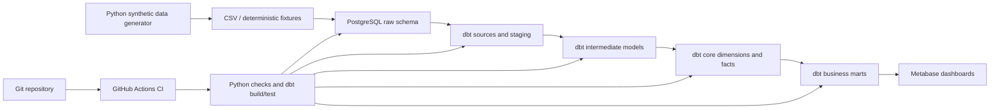
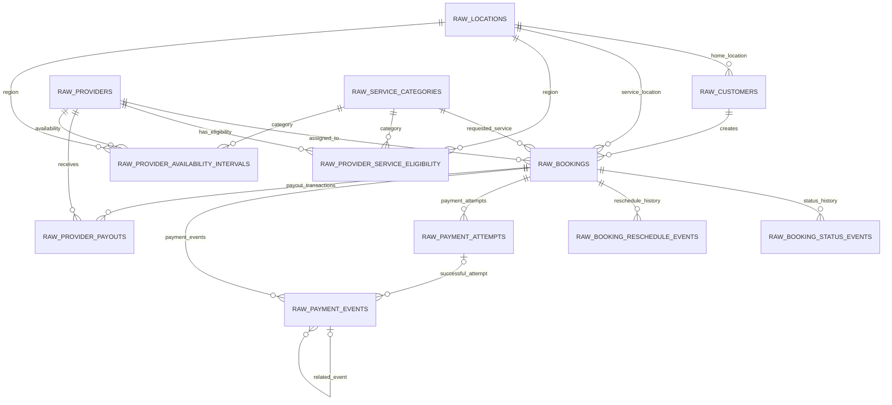
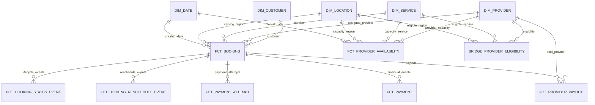
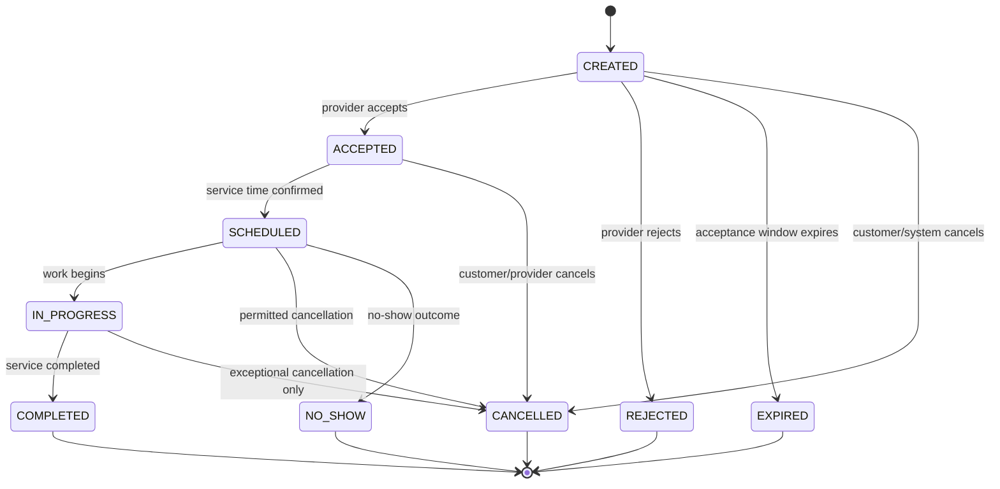
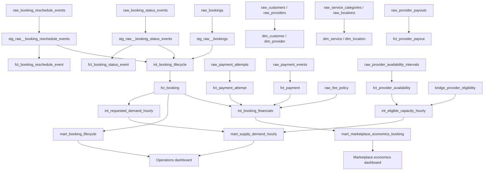

# Technical Architecture Document (TAD)

## Marketplace Supply & Fulfillment Warehouse

**Suggested repository:** `marketplace-fulfillment-warehouse`  
**Document type:** Technical Architecture Document  
**Status:** Baseline approved for MVP implementation  
**Version:** 1.0  
**Date:** 10 November 2026  
**Companion:** [`PRD.md`](PRD.md)

---

## 1. Purpose

This document translates the project requirements into an implementable data architecture. It defines system boundaries, source contracts, entity relationships, grains, dimensions and facts, metric dependencies, transformation layers, financial rules, lifecycle reconstruction, capacity calculations, tests, incremental-processing behavior, local runtime, CI, and build order.

The design is intentionally sized for a recruiter-facing Analytics Engineering portfolio project. It is not a production marketplace backend. It uses synthetic records and a local-first implementation that can be reproduced from a public GitHub repository.

## 2. Architecture principles

1. **Separate business processes.** Booking status, customer payment, platform fee, provider earnings, provider payout, provider eligibility, and provider availability are different concepts.
2. **Declare grain before SQL.** Every fact and mart has one documented row meaning.
3. **Preserve events.** Booking status and financial events are append-only business history; state is derived from events.
4. **Use stable identities.** Source business IDs and event IDs remain stable across reprocessing.
5. **Use explicit time semantics.** Event time, ingestion time, requested service time, scheduled service time, completion time, and payout time are not interchangeable.
6. **Make metric contracts executable.** Important business logic is documented and tested, not hidden in dashboard expressions.
7. **Use a dimensional model for analytics.** Facts carry measurable events/processes; dimensions provide descriptive context and effective-dated profiles.
8. **Prevent double counting.** Validate joins at declared grains and avoid joining multiple one-to-many facts before aggregating.
9. **Keep optional infrastructure optional.** No Kafka, Airflow, Dagster, mandatory DuckDB, or geospatial extension in the MVP.
10. **Build in dependency order.** Source and lifecycle correctness precede financial and capacity marts; dashboards come last.

## 3. System architecture

### 3.1 Logical architecture



### 3.2 Pipeline boundaries

| Boundary | Input | Output | Responsibility | Does not do |
|---|---|---|---|---|
| Synthetic generation | Seed, scale, scenario configuration | CSV/fixture source files | Generate coherent fictional entities, events, amounts, and availability | Does not calculate final dashboard metrics |
| Raw ingestion | Generated source files | PostgreSQL `raw` tables | Load source-shaped rows and preserve source identifiers/ingestion metadata | Does not silently deduplicate or overwrite event history |
| dbt staging | Raw tables | `staging` views/models | Rename, cast, normalize status/type values, apply source-level validity checks | Does not apply complex business metric logic |
| dbt intermediate | Staging models | `intermediate` models | Reconstruct booking state, identify current scheduled time, calculate financial allocations, interval intersections | Does not present final dashboard definitions as undocumented SQL |
| dbt core | Intermediate models | `core` dimensions, bridges, facts | Publish tested dimensional structures at explicit grains | Does not aggregate unrelated grains together |
| dbt marts | Core facts/dimensions | `marts` tables/views | Publish booking lifecycle, marketplace economics, and supply/capacity analysis | Does not redefine business rules independently per dashboard |
| BI | Marts | Metabase dashboards | Display governed metrics and filters | Does not become the source of truth for metric calculation |
| CI | Git change, small fixtures, project config | Test/build result | Catch breaking changes and invalid data assumptions | Does not require a production deployment |

### 3.3 Recommended local runtime

- **Docker Compose:** PostgreSQL and Metabase services.
- **Local Python virtual environment:** synthetic generator, loader, and pytest.
- **Local dbt Core environment:** dbt project and transformations.
- **Git/GitHub:** source control and documentation.
- **GitHub Actions:** lightweight CI using a PostgreSQL service/container or a documented test database setup.

Python and dbt do not need to run inside Docker for the first implementation. This keeps debugging straightforward on Windows while making the database and BI services reproducible.

### 3.4 PostgreSQL schemas

| Schema | Contents | Owner/use |
|---|---|---|
| `raw` | Source-shaped synthetic tables | Loader writes; transformations read |
| `staging` | Cleaned source models | dbt-managed |
| `intermediate` | Lifecycle, event, financial and interval calculations | dbt-managed |
| `core` | Dimensions, bridges and atomic facts | dbt-managed |
| `marts` | Business-facing analytical outputs | dbt-managed; Metabase reads |

The exact dbt `target.schema`/custom schema naming configuration can be adapted to dbt conventions, but the logical separation must remain visible.

## 4. Technology choices and responsibilities

| Technology | Responsibility | Decision |
|---|---|---|
| Python | Deterministic synthetic data, edge-case fixtures, source loading | Core |
| PostgreSQL | Raw persistence and warehouse database | Core |
| SQL | Data transformations and reconciliation | Core |
| dbt Core | Dependency graph, models, tests, documentation | Core |
| Git/GitHub | Version history, code review, portfolio repository | Core |
| GitHub Actions | Automated Python/dbt validation | Core |
| Metabase | Operations and economics dashboards | Core |
| Docker Compose | Reproducible PostgreSQL and Metabase services | Recommended |
| DuckDB | Optional larger analytical file processing | Deferred |
| Airflow/Dagster | Optional orchestration practice | Deferred |
| PostGIS/geospatial extension | Optional distance/polygon analysis | Deferred |
| Kafka/stream processor | Streaming simulation | Excluded from MVP |

## 5. Data architecture and naming conventions

### 5.1 Naming

- Raw source tables: `raw_<entity_or_event>`.
- dbt staging models: `stg_<source>__<entity>`.
- Intermediate models: `int_<business_process>__<purpose>`.
- Dimensions: `dim_<entity>`.
- Atomic facts: `fct_<process_or_event>`.
- Bridges: `bridge_<entity_relationship>`.
- Business marts: `mart_<business_area>_<grain>`.
- Primary keys: `<entity>_id` in raw source tables; `<entity>_sk` in dimensional tables.
- Timestamps end in `_at`; dates end in `_date` or use a date surrogate key.
- Amounts carry a currency column and use `numeric(12,2)`; no floating-point money values.
- Durations use integer minutes in source records; derived time values may use numeric hours.

### 5.2 Key strategy

- Raw business/event IDs: UUIDs generated deterministically by Python (UUIDv5 or equivalent stable generation from the seed and business natural key).
- Dimensional surrogate keys: integer/bigint surrogate keys generated by dbt/database strategy.
- Facts retain source business IDs as degenerate identifiers for traceability.
- Every event fact retains its source event UUID and idempotency key.
- Do not generate a new random ID each time the same synthetic source row is regenerated with the same seed.

### 5.3 Timestamp and reporting rules

- Store timestamps as PostgreSQL `timestamptz` in UTC.
- Set the database/session timezone explicitly during development and ingestion.
- Convert to `America/New_York` in reporting/date-dimension derivation.
- Preserve event occurrence time and ingestion time separately.
- Use booking creation date for booking cohorts; requested/current scheduled service time for operational capacity; financial event time for payment/refund reporting; payout time for disbursement reporting.

## 6. Source data contracts

All source tables are in the `raw` schema. The Python generator writes a consistent source snapshot or batch. Raw event tables are append-only. Profile tables may contain effective-dated versions so dimensions can represent historical profile attributes.

### 6.1 Source table grains

| Source table | Grain | Primary key | Important foreign keys |
|---|---|---|---|
| `raw_customers` | One customer profile version | `customer_record_id` | `home_location_id` |
| `raw_providers` | One provider profile version | `provider_record_id` | Optional `home_location_id` if populated |
| `raw_service_categories` | One service category | `service_category_id` | — |
| `raw_locations` | One neighborhood/service region | `location_id` | — (borough stored as an attribute) |
| `raw_provider_service_eligibility` | One provider × category × location eligibility interval | `eligibility_id` | `provider_id`, `service_category_id`, `location_id` |
| `raw_bookings` | One booking | `booking_id` | `customer_id`, optional `provider_id`, `service_category_id`, `service_location_id` |
| `raw_booking_status_events` | One booking status transition | `event_id` | `booking_id`, optional actor/provider ID |
| `raw_booking_reschedule_events` | One booking reschedule event | `reschedule_event_id` | `booking_id` |
| `raw_payment_attempts` | One customer payment attempt | `payment_attempt_id` | `booking_id` |
| `raw_payment_events` | One posted capture, refund, or reversal event | `payment_event_id` | `booking_id`, optional `payment_attempt_id`, optional related event ID |
| `raw_provider_payouts` | One provider payout transaction | `payout_id` | `booking_id`, `provider_id` |
| `raw_provider_availability_intervals` | One provider availability/block interval | `availability_id` | `provider_id`, `service_category_id`, `location_id` |
| `raw_fee_policy` | One effective-dated fee policy version | `fee_policy_id` | — |

### 6.2 `raw_customers`

One row per version of a customer's synthetic profile. A profile change creates a new version with effective dates; it does not overwrite historical profile values.

| Column | Type | Nullable? | Meaning |
|---|---|---:|---|
| `customer_record_id` | `uuid` | No | Unique ID for this profile version; PK |
| `customer_id` | `uuid` | No | Stable customer business ID shared by profile versions |
| `home_location_id` | `varchar(40)` | Yes | Synthetic home neighborhood/location ID |
| `customer_segment` | `varchar(30)` | Yes | Synthetic segment label, if generated |
| `account_status` | `varchar(20)` | No | Profile status such as `ACTIVE` or `INACTIVE` |
| `created_at` | `timestamptz` | No | Original customer creation time |
| `effective_from` | `timestamptz` | No | Start of this profile version's validity |
| `effective_to` | `timestamptz` | Yes | End of validity; null while open/current |
| `is_current` | `boolean` | No | Whether this is the current profile version |
| `source_loaded_at` | `timestamptz` | No | Raw ingestion time |

### 6.3 `raw_providers`

One row per version of a provider's synthetic profile.

| Column | Type | Nullable? | Meaning |
|---|---|---:|---|
| `provider_record_id` | `uuid` | No | Unique profile-version ID; PK |
| `provider_id` | `uuid` | No | Stable provider business ID |
| `home_location_id` | `varchar(40)` | Yes | Synthetic provider home neighborhood |
| `provider_status` | `varchar(20)` | No | `ACTIVE`, `INACTIVE`, or another documented status |
| `provider_tier` | `varchar(20)` | Yes | Optional synthetic provider tier |
| `created_at` | `timestamptz` | No | Original provider creation time |
| `effective_from` | `timestamptz` | No | Start of this version's validity |
| `effective_to` | `timestamptz` | Yes | End of this version's validity; null if current |
| `is_current` | `boolean` | No | Current profile-version indicator |
| `source_loaded_at` | `timestamptz` | No | Raw ingestion time |

### 6.4 `raw_service_categories`

| Column | Type | Nullable? | Meaning |
|---|---|---:|---|
| `service_category_id` | `varchar(40)` | No | Stable category ID; PK |
| `service_category_name` | `varchar(100)` | No | Furniture assembly, home cleaning, plumbing, electrical repairs, painting, or moving assistance |
| `is_active` | `boolean` | No | Whether category is active in the generated catalog |

### 6.5 `raw_locations`

One row per neighborhood/service region. Borough is stored as an attribute to avoid an unnecessary hierarchy table for this MVP.

| Column | Type | Nullable? | Meaning |
|---|---|---:|---|
| `location_id` | `varchar(40)` | No | Stable neighborhood/service-region ID; PK |
| `borough_name` | `varchar(60)` | No | One of the five NYC borough labels |
| `neighborhood_name` | `varchar(100)` | No | Synthetic neighborhood label |
| `is_active` | `boolean` | No | Whether region is in the synthetic catalog |

### 6.6 `raw_provider_service_eligibility`

One row per provider/service-category/location eligibility interval. Eligibility says the provider is permitted/qualified to accept that work; it does not say that the provider is free at a given time.

| Column | Type | Nullable? | Meaning |
|---|---|---:|---|
| `eligibility_id` | `uuid` | No | Unique eligibility-interval ID; PK |
| `provider_id` | `uuid` | No | Provider business ID |
| `service_category_id` | `varchar(40)` | No | Eligible service category |
| `location_id` | `varchar(40)` | No | Eligible service region |
| `effective_from` | `timestamptz` | No | Start of eligibility |
| `effective_to` | `timestamptz` | Yes | End of eligibility; null while active |
| `is_eligible` | `boolean` | No | Eligibility flag for this interval |
| `source_loaded_at` | `timestamptz` | No | Raw ingestion time |

### 6.7 `raw_bookings`

One row per customer booking request. This table stores request attributes and the assigned provider (nullable); the event table stores lifecycle history.

| Column | Type | Nullable? | Meaning |
|---|---|---:|---|
| `booking_id` | `uuid` | No | Stable booking ID; PK |
| `customer_id` | `uuid` | No | Customer who requested the service |
| `provider_id` | `uuid` | Yes | Assigned provider; null if not assigned/accepted |
| `service_category_id` | `varchar(40)` | No | Requested service category |
| `service_location_id` | `varchar(40)` | No | Neighborhood where service is requested |
| `created_at` | `timestamptz` | No | Booking creation timestamp |
| `requested_start_at` | `timestamptz` | No | Initially requested service start time |
| `requested_duration_minutes` | `integer` | No | Requested service duration in minutes; positive |
| `service_value_amount` | `numeric(12,2)` | No | Service value in USD, excluding taxes and tips |
| `currency` | `char(3)` | No | `USD` for the MVP |
| `is_test_booking` | `boolean` | No | Whether the record is a test/fixture booking; excluded from business metrics |
| `source_loaded_at` | `timestamptz` | No | Raw ingestion time |

### 6.8 `raw_booking_status_events`

Append-only, one row per status transition. Creation is represented as the first transition from null to `CREATED`.

| Column | Type | Nullable? | Meaning |
|---|---|---:|---|
| `event_id` | `uuid` | No | Unique status-event ID; PK |
| `booking_id` | `uuid` | No | Booking whose status changed |
| `event_sequence` | `integer` | No | Deterministic sequence within booking for same-time tie-breaking |
| `from_status` | `varchar(30)` | Yes | Prior status; null for the creation event |
| `to_status` | `varchar(30)` | No | New status |
| `occurred_at` | `timestamptz` | No | Business event time |
| `actor_type` | `varchar(20)` | No | `CUSTOMER`, `PROVIDER`, `SYSTEM`, or documented synthetic actor |
| `actor_id` | `uuid` | Yes | Customer/provider/system actor ID when applicable |
| `reason_code` | `varchar(50)` | Yes | Cancellation/rejection/expiry/no-show reason where applicable |
| `idempotency_key` | `varchar(120)` | No | Stable unique key to prevent duplicate processing |
| `source_loaded_at` | `timestamptz` | No | Ingestion time; may be later than occurred time |

### 6.9 `raw_booking_reschedule_events`

Append-only, one row per reschedule. The booking ID is preserved.

| Column | Type | Nullable? | Meaning |
|---|---|---:|---|
| `reschedule_event_id` | `uuid` | No | Unique reschedule-event ID; PK |
| `booking_id` | `uuid` | No | Booking being rescheduled |
| `old_scheduled_start_at` | `timestamptz` | No | Scheduled start before the change |
| `new_scheduled_start_at` | `timestamptz` | No | New scheduled start |
| `occurred_at` | `timestamptz` | No | Time the reschedule was requested/recorded |
| `actor_type` | `varchar(20)` | No | `CUSTOMER`, `PROVIDER`, or `SYSTEM` |
| `reason_code` | `varchar(50)` | Yes | Optional reschedule reason |
| `idempotency_key` | `varchar(120)` | No | Stable duplicate-prevention key |
| `source_loaded_at` | `timestamptz` | No | Ingestion time |

### 6.10 `raw_payment_attempts`

One row per attempted customer payment. Attempts are not posted financial transactions.

| Column | Type | Nullable? | Meaning |
|---|---|---:|---|
| `payment_attempt_id` | `uuid` | No | Unique attempt ID; PK |
| `booking_id` | `uuid` | No | Booking associated with the attempt |
| `attempt_number` | `integer` | No | Attempt order for the booking/payment intent |
| `attempted_at` | `timestamptz` | No | Attempt timestamp |
| `attempt_status` | `varchar(20)` | No | `SUCCEEDED` or `FAILED` for this MVP |
| `amount` | `numeric(12,2)` | No | Attempted service-value amount, USD |
| `currency` | `char(3)` | No | `USD` |
| `failure_code` | `varchar(50)` | Yes | Synthetic failure reason when failed |
| `idempotency_key` | `varchar(120)` | No | Stable attempt-processing key |
| `source_loaded_at` | `timestamptz` | No | Ingestion time |

### 6.11 `raw_payment_events`

One row per posted customer capture, refund, or reversal. Amount is a positive magnitude; event type determines the balance effect. The MVP supports reversals of captures; reversal-of-refund complexity is outside initial scope.

| Column | Type | Nullable? | Meaning |
|---|---|---:|---|
| `payment_event_id` | `uuid` | No | Unique financial event ID; PK |
| `booking_id` | `uuid` | No | Booking associated with the event |
| `payment_attempt_id` | `uuid` | Yes | Successful attempt for capture; null for some later events |
| `related_payment_event_id` | `uuid` | Yes | Original capture/event referenced by refund or reversal |
| `event_type` | `varchar(20)` | No | `CAPTURE`, `REFUND`, or `REVERSAL` |
| `amount` | `numeric(12,2)` | No | Positive magnitude in USD |
| `currency` | `char(3)` | No | `USD` |
| `occurred_at` | `timestamptz` | No | Financial event time |
| `idempotency_key` | `varchar(120)` | No | Stable duplicate-prevention key |
| `source_loaded_at` | `timestamptz` | No | Ingestion time |

### 6.12 `raw_provider_payouts`

One row per provider payout transaction. A payout is a cash-disbursement event, not the calculation of what the provider earned.

| Column | Type | Nullable? | Meaning |
|---|---|---:|---|
| `payout_id` | `uuid` | No | Unique payout transaction ID; PK |
| `booking_id` | `uuid` | No | Booking for which this payout is issued |
| `provider_id` | `uuid` | No | Provider receiving payout |
| `amount` | `numeric(12,2)` | No | Payout amount, positive magnitude, USD |
| `currency` | `char(3)` | No | `USD` |
| `payout_status` | `varchar(20)` | No | `PENDING`, `PAID`, `FAILED`, or `REVERSED` |
| `initiated_at` | `timestamptz` | No | Payout initiation time |
| `paid_at` | `timestamptz` | Yes | Actual paid timestamp; non-null only when paid |
| `idempotency_key` | `varchar(120)` | No | Stable payout-processing key |
| `source_loaded_at` | `timestamptz` | No | Ingestion time |

### 6.13 `raw_provider_availability_intervals`

One row per provider interval. Each interval is associated with exactly one service category and one service region. In the MVP generator, intervals for a provider cannot overlap, even across categories/regions, to prevent capacity double counting.

| Column | Type | Nullable? | Meaning |
|---|---|---:|---|
| `availability_id` | `uuid` | No | Unique interval ID; PK |
| `provider_id` | `uuid` | No | Provider declaring availability |
| `service_category_id` | `varchar(40)` | No | Category for this interval |
| `location_id` | `varchar(40)` | No | Region for this interval |
| `start_at` | `timestamptz` | No | Interval start, inclusive |
| `end_at` | `timestamptz` | No | Interval end, exclusive; must be after start |
| `availability_status` | `varchar(20)` | No | `OPEN` or `BLOCKED` |
| `source_loaded_at` | `timestamptz` | No | Ingestion time |

### 6.14 `raw_fee_policy`

One row per effective-dated fixed platform fee policy. This makes the fee rate configurable and historically traceable.

| Column | Type | Nullable? | Meaning |
|---|---|---:|---|
| `fee_policy_id` | `uuid` | No | Fee policy version ID; PK |
| `fee_rate` | `numeric(7,6)` | No | Fractional rate; e.g. `0.150000` means 15% |
| `effective_from` | `timestamptz` | No | Start of policy validity |
| `effective_to` | `timestamptz` | Yes | End of policy validity; null if current |
| `currency` | `char(3)` | No | `USD` |
| `source_loaded_at` | `timestamptz` | No | Ingestion time |

A 15% fee rate may be used as a synthetic seed default, but it must remain configurable and must be labeled as fictional.

## 7. Entity relationship diagrams

### 7.1 Source/raw ERD



`raw_customers` and `raw_providers` are effective-dated profile-version tables; the relationship labels above refer to stable business IDs, not necessarily the profile-version primary key.

### 7.2 Analytics model ERD (conceptual)



### 7.3 Relationship cardinality rules

- One customer can create many bookings; each booking belongs to exactly one customer.
- One provider can be assigned to many bookings; each booking has zero or one assigned provider.
- One service category and one service location belong to each booking.
- One booking has many status events, reschedule events, payment attempts, and financial events.
- One payment attempt can produce zero or one successful capture event in the MVP.
- One capture can have multiple refund/reversal events, subject to cumulative refundable-balance rules.
- One booking can have zero or more provider payout transactions; one payout transaction belongs to one booking and one provider.
- One provider has many eligibility intervals and many availability intervals.
- Availability is category- and location-specific; eligibility is modeled independently.

## 8. Booking lifecycle architecture

### 8.1 State model



The state map is a project business rule, not a universal marketplace standard. The generator and dbt tests must use the same allowed-transition contract.

### 8.2 Allowed transition contract

| From | To | Allowed? | Guard / explanation |
|---|---|---:|---|
| null | `CREATED` | Yes | Exactly one creation event per booking |
| `CREATED` | `ACCEPTED` | Yes | Provider assigned and eligible for category/region |
| `CREATED` | `REJECTED` | Yes | Provider or matching outcome rejects request |
| `CREATED` | `EXPIRED` | Yes | Acceptance window expires |
| `CREATED` | `CANCELLED` | Yes | Customer/system cancels before acceptance |
| `ACCEPTED` | `SCHEDULED` | Yes | Service slot is confirmed |
| `ACCEPTED` | `CANCELLED` | Yes | Customer/provider cancellation reason required |
| `SCHEDULED` | `IN_PROGRESS` | Yes | Work begins at/around scheduled time |
| `SCHEDULED` | `CANCELLED` | Yes | Cancellation before work begins |
| `SCHEDULED` | `NO_SHOW` | Yes | Scheduled service not fulfilled; reason/actor captured when known |
| `IN_PROGRESS` | `COMPLETED` | Yes | Completion timestamp follows start timestamp |
| `IN_PROGRESS` | `CANCELLED` | Exceptional | Only when the synthetic scenario records work stopped before completion |
| Any terminal state | Another ordinary state | No | Terminal outcome is final in the MVP |
| Any other transition | — | No | Must fail generator/dbt validation |

### 8.3 Event ordering and final-state reconstruction

1. Order events by `occurred_at`, then `event_sequence`, then `event_id` as deterministic tie-breakers.
2. Validate that `from_status` equals the prior reconstructed state and that the transition is allowed.
3. First event must be null → `CREATED`.
4. Final status is the `to_status` of the last valid event.
5. Derive lifecycle timestamps using the first valid occurrence of each relevant state.
6. Store raw events unchanged. Corrections are represented explicitly or handled by regenerating the synthetic dataset; do not silently mutate history.

### 8.4 Rescheduling

Reschedule events are separate from status transitions. The initially requested start time comes from `raw_bookings.requested_start_at`. The current scheduled start is derived by applying reschedule events ordered by `occurred_at` and `reschedule_event_id`. The old start in each event must equal the previously current scheduled start. Rescheduling does not create a new booking or new demand count.

## 9. Payment, refund, fee, earnings, and payout architecture

### 9.1 Separate financial concepts

| Concept | Meaning | Source / model |
|---|---|---|
| Payment attempt | Attempt to collect customer payment; may fail or succeed | `raw_payment_attempts` → `fct_payment_attempt` |
| Capture | Posted successful customer payment | `raw_payment_events` where `event_type='CAPTURE'` → `fct_payment` |
| Refund | Money returned to customer | `raw_payment_events` where `event_type='REFUND'` → `fct_payment` |
| Reversal | Posted reversal of a prior capture | `raw_payment_events` where `event_type='REVERSAL'` → `fct_payment` |
| Platform fee revenue | Platform's fee earned on eligible completed service value after fee reversals | Derived in `int_booking_financials` / economics mart |
| Provider earnings | Net amount owed to provider under the fee/refund policy | Derived in `int_booking_financials` / economics mart |
| Provider payout | Actual disbursement record and its status/date | `raw_provider_payouts` → `fct_provider_payout` |

### 9.2 Payment-attempt rules

- Multiple attempts may exist for one booking.
- Attempts are ordered by `attempt_number`, then `attempted_at`.
- Failed attempts do not create capture value.
- A successful attempt is linked to a capture event.
- For the synthetic MVP, a booking may only transition to `COMPLETED` if a successful capture exists for the service value. A failed payment may be retried; if all attempts fail, the booking cannot complete in the generated lifecycle. This constraint keeps the completed-service financial fixtures reconcilable.
- This is a simplified project assumption, not a universal payment-processing rule.

### 9.3 Posted financial-event rules

- `CAPTURE` increases collected customer service value.
- `REFUND` decreases collected customer service value and references the original capture.
- `REVERSAL` decreases the captured balance and references the original capture; reversal-of-refund cases are out of MVP scope.
- Event amount is stored as positive magnitude; the dbt model derives signed effect from event type.
- Refund/reversal cumulative amount must not exceed the original capture amount.
- Payment events are idempotent by `payment_event_id` and `idempotency_key`.

### 9.4 Completed GMV eligibility and reconciliation policy

For this project, completed-service GMV is service value for valid bookings that reach `COMPLETED`. The synthetic generator enforces a successful capture for completed bookings, so the completed-service population reconciles to posted captured value before refunds. If a later edge case intentionally violates that rule, it must be reported separately as completed-but-uncollected value rather than silently included in fee revenue.

- `gross_completed_gmv`: sum of service value for completed eligible bookings before refunds.
- `net_completed_gmv`: gross completed GMV less service-value refunds/reversals allocated to those completed bookings.
- Only refunds/reversals related to eligible completed service are applied to completed GMV. Refunds for a cancelled or non-completed booking are reported in customer financial activity but do not reduce completed-service GMV because the booking was never part of its numerator.
- Money uses `numeric(12,2)` and rounds to cents using a documented deterministic rounding rule (PostgreSQL `round` at calculation boundary).

### 9.5 Platform fee policy

- Fee rate comes from `raw_fee_policy`, selected using the booking completion timestamp. The same rate is used for any later proportional fee reversal tied to that booking.
- Synthetic seed default may be 15%; configurable and clearly identified as fictional.
- Gross fee = eligible gross completed GMV × fee rate.
- Fee reversal = eligible service-value refund/reversal × same applicable fee rate.
- Net platform fee revenue = gross fee − fee reversal.
- Cancellation fees are not generated in MVP and are excluded from primary platform revenue/take rate.
- Taxes and tips are not modeled in the primary service-value amount and are excluded.

### 9.6 Take rate, provider earnings, payout

- Primary take rate = net platform fee revenue ÷ net completed GMV × 100 for the same reporting scope.
- Provider earnings = net completed GMV − net platform fee revenue under the baseline policy.
- Provider payout is the sum of payout records with `payout_status='PAID'`, grouped by `paid_at` for cash disbursement reporting.
- Pending/failed/reversed payout amounts are shown separately and are not counted as paid payouts.
- Provider earnings are attributed to completed-booking/service period; provider payout is attributed to payout date. Do not join or compare them without making the date basis explicit.

### 9.7 Hand-calculated financial fixture

Assume a 15% synthetic fee policy:

| Event / metric | Amount |
|---|---:|
| Completed service value and customer capture | $100.00 |
| Gross completed GMV | $100.00 |
| Customer partial refund | $20.00 |
| Net completed GMV | $80.00 |
| Gross platform fee (15% × $100) | $15.00 |
| Platform fee reversal (15% × $20) | $3.00 |
| Net platform fee revenue | $12.00 |
| Provider earnings ($80 − $12) | $68.00 |
| Example paid provider payout | $68.00 |

The test fixture must prove these values. A separate failed-attempt fixture must show that failed attempts do not add captured value. A duplicate payment-event fixture must show that reprocessing does not change these totals.

## 10. Provider eligibility, availability, capacity, and demand

### 10.1 Eligibility versus availability

- **Eligibility:** provider may serve a category in a region during an effective interval.
- **Availability:** provider declared an open time interval for that category and region.
- **Booking assignment:** provider is attached to a specific booking.

These are separate datasets. A provider being eligible does not mean they are available, and an available interval does not automatically imply that they accepted a booking.

### 10.2 Availability interval rules

- Time interval convention: `[start_at, end_at)` (start inclusive, end exclusive).
- `end_at` must be greater than `start_at`.
- Each interval maps to exactly one provider, category, and location.
- No overlap for a provider across any categories/locations in the MVP source fixture.
- `OPEN` intervals contribute to supply capacity; `BLOCKED` intervals do not.
- Capacity is clipped to the aggregation window before minutes are summed.
- Only intervals for active/eligible providers and matching service category/location are included.

### 10.3 Demand definition

MVP demand is recorded booking-based demand:

- Include valid non-test booking requests.
- Use requested/current service time as the time-slot allocation basis according to the metric definition; default supply-demand analysis uses the original requested service slot so that demand is not erased by subsequent completion/cancellation outcomes.
- Allocate requested duration across hourly buckets. A 90-minute request beginning at 10:30 contributes 0.5 hour to the 10:00 bucket and 1.0 hour to the 11:00 bucket only if its end passes 12:00; allocation logic must split exact interval overlap, not round the entire booking into one hour.
- Booking-based demand excludes unrecorded searches and customers who never created a booking.

### 10.4 Capacity definition

- Eligible available capacity is the sum of `OPEN` provider-availability minutes intersecting the same hourly bucket, service category, and location as demand.
- Use effective eligibility as of interval start.
- Because each provider has no overlapping intervals in the MVP, provider-minutes are not counted twice.
- Capacity represents declared available provider time, not guaranteed labor, actual attendance, or leftover unbooked time after allocation.

### 10.5 Modeled supply-demand gap

At grain **one hour × one service category × one neighborhood**:

`modeled_gap_hours = requested_demand_hours - eligible_available_capacity_hours`

- Positive: recorded requested service hours exceed modeled declared capacity hours.
- Negative: modeled declared capacity exceeds recorded requested service hours.
- This is an analytical indicator only. Without search/no-match/unfulfilled-attempt events, the project cannot claim the actual quantity of lost or unmet demand.
- Dashboard text must use “modeled supply-demand gap” or similar, never “confirmed unmet demand.”

### 10.6 Provider utilization

Primary metric: **reserved utilization rate**.

`reserved_utilization_rate = reserved_booking_minutes_in_open_availability / open_available_minutes × 100`

Reserved minutes come from valid accepted/scheduled/in-progress/completed bookings assigned to an eligible provider and scheduled in the relevant interval. Canceled bookings are excluded from reserved time for a current-state utilization view. The calculation must intersect booking service windows with provider availability intervals so it cannot assign more minutes than a provider has available.

Optional companion metric: completed utilization based on completed service duration, if actual service start/end are available. Do not label scheduled reserved utilization as actual labor utilization.

## 11. Dimensional modeling strategy

### 11.1 Dimensions

| Model | Grain | Key | Strategy |
|---|---|---|---|
| `dim_customer` | One customer profile version | `customer_sk` | Type 2 effective-dated dimension |
| `dim_provider` | One provider profile version | `provider_sk` | Type 2 effective-dated dimension |
| `dim_service` | One service category | `service_sk` | Type 1 for MVP catalog labels |
| `dim_location` | One neighborhood/service region | `location_sk` | Type 1; includes borough attribute |
| `dim_date` | One calendar date | `date_key` | Static calendar dimension |

### 11.2 Type 2 dimension rules

For customer/provider versions:

- Generate a new surrogate key when tracked attributes change.
- `effective_from` is inclusive; `effective_to` is exclusive.
- Current row has `effective_to IS NULL` and `is_current = true`.
- No overlapping effective intervals for the same natural business ID.
- Facts use the dimension version valid at the business event time: customer at booking creation; provider at provider assignment/acceptance or payout time according to the fact role.

The generator need not create many profile changes; one or two deterministic profile updates are sufficient to demonstrate SCD2. If profile changes are not generated in the first MVP data set, the schema and tests should still support the versioning contract.

### 11.3 Role-playing dates

`dim_date` can be joined using different foreign keys such as booking-created date, requested-service date, completed date, financial-event date, and payout date. In Metabase, ensure the date field label makes the role clear. Do not use one ambiguous `date` dimension join for every metric.

## 12. Fact and bridge model specifications

| Model | Grain | Primary/unique key | Measures / purpose |
|---|---|---|---|
| `fct_booking` | One booking | `booking_id` | One-row current/final lifecycle representation, service value, requested duration, lifecycle timestamps, final outcome |
| `fct_booking_status_event` | One booking status transition | `event_id` | Event history and stage-transition analysis |
| `fct_booking_reschedule_event` | One booking reschedule event | `reschedule_event_id` | Original/new scheduled time history; retains booking identity |
| `fct_payment_attempt` | One payment attempt | `payment_attempt_id` | Attempt amount, success/failure, retries |
| `fct_payment` | One posted customer capture/refund/reversal | `payment_event_id` | Financial event amount, event type, signed effect |
| `fct_provider_payout` | One provider payout transaction | `payout_id` | Payout amount/status/initiated/paid time |
| `fct_provider_availability` | One provider availability/block interval | `availability_id` | Open/blocked provider minutes |
| `bridge_provider_eligibility` | One provider × category × location eligibility interval | `eligibility_id` | Effective-dated provider eligibility |

### 12.1 `fct_booking`

One row per booking, derived from raw booking request plus validated event history. It is a current/final-state fact; event history remains in `fct_booking_status_event`.

Expected fields:

- `booking_id` (degenerate identifier / PK)
- `customer_sk`
- `provider_sk` (nullable if never assigned)
- `service_sk`
- `location_sk`
- `created_date_key`
- `requested_service_date_key`
- `completed_date_key` (nullable)
- `created_at`
- `accepted_at` (nullable)
- `scheduled_at` (nullable)
- `in_progress_at` (nullable)
- `completed_at` (nullable)
- `terminal_at` (nullable)
- `requested_start_at`
- `current_scheduled_start_at` (nullable before scheduled)
- `requested_duration_minutes`
- `service_value_amount`
- `currency`
- `final_status`
- `is_eligible_booking`
- `is_test_booking`
- `source_loaded_at` / last source update timestamp

`final_status` is derived from the last valid event. The booking row must not be the only place where lifecycle changes are stored.

### 12.2 `fct_booking_status_event`

One row per status transition. Preserve:

- `event_id`, `booking_id`, `event_sequence`
- `from_status`, `to_status`
- `occurred_at`, `event_date_key`
- `actor_type`, `actor_id`, `reason_code`
- `idempotency_key`, `source_loaded_at`

### 12.3 `fct_payment_attempt`

One row per attempt. Preserve failed attempts and retries. Do not count attempted amounts as collected cash.

### 12.4 `fct_payment`

One row per posted capture/refund/reversal event. Include `amount` as positive magnitude and a derived `signed_amount` (capture positive, refund negative, capture reversal negative). Include related capture ID and attempt ID where available.

### 12.5 `fct_provider_payout`

One row per payout transaction. Include `provider_sk` resolved at payout initiation or paid time (document the chosen lookup; use paid time for paid-payout reporting), amount, status, initiated time, and paid time.

### 12.6 `fct_provider_availability`

One row per interval; store provider/service/location keys, start/end, interval minutes, status, and date/hour role keys as needed. Do not pre-aggregate away the interval endpoints needed for overlap logic.

### 12.7 `bridge_provider_eligibility`

One row per effective-dated provider/service/location eligibility interval. Use it for booking assignment validation and capacity qualification.

## 13. Data dictionary for analytical models

This section defines the expected core and mart columns. Implementations may add technical columns such as dbt invocation ID, but must not change the stated grain.

### 13.1 Dimensions

#### `core.dim_customer` — one customer profile version

| Column | Type | Nullable? | Meaning |
|---|---|---:|---|
| `customer_sk` | `bigint` | No | Surrogate primary key |
| `customer_id` | `uuid` | No | Stable source customer ID |
| `home_location_sk` | `bigint` | Yes | Current historical-version home location, if available |
| `customer_segment` | `varchar(30)` | Yes | Synthetic segment |
| `account_status` | `varchar(20)` | No | Profile status |
| `effective_from` | `timestamptz` | No | Inclusive version start |
| `effective_to` | `timestamptz` | Yes | Exclusive version end; null for current |
| `is_current` | `boolean` | No | Current version flag |

#### `core.dim_provider` — one provider profile version

| Column | Type | Nullable? | Meaning |
|---|---|---:|---|
| `provider_sk` | `bigint` | No | Surrogate primary key |
| `provider_id` | `uuid` | No | Stable source provider ID |
| `home_location_sk` | `bigint` | Yes | Provider home location, if modeled |
| `provider_status` | `varchar(20)` | No | Provider profile status |
| `provider_tier` | `varchar(20)` | Yes | Optional synthetic tier |
| `effective_from` | `timestamptz` | No | Inclusive version start |
| `effective_to` | `timestamptz` | Yes | Exclusive version end; null for current |
| `is_current` | `boolean` | No | Current version flag |

#### `core.dim_service` — one service category

| Column | Type | Nullable? | Meaning |
|---|---|---:|---|
| `service_sk` | `bigint` | No | Surrogate primary key |
| `service_category_id` | `varchar(40)` | No | Source category ID |
| `service_category_name` | `varchar(100)` | No | Readable category name |
| `is_active` | `boolean` | No | Active flag |

#### `core.dim_location` — one neighborhood/service region

| Column | Type | Nullable? | Meaning |
|---|---|---:|---|
| `location_sk` | `bigint` | No | Surrogate primary key |
| `location_id` | `varchar(40)` | No | Source location ID |
| `borough_name` | `varchar(60)` | No | NYC borough label |
| `neighborhood_name` | `varchar(100)` | No | Synthetic neighborhood label |
| `is_active` | `boolean` | No | Active region flag |

#### `core.dim_date` — one calendar date

| Column | Type | Nullable? | Meaning |
|---|---|---:|---|
| `date_key` | `integer` | No | `YYYYMMDD` primary key |
| `full_date` | `date` | No | Calendar date |
| `year_number` | `smallint` | No | Calendar year |
| `quarter_number` | `smallint` | No | Calendar quarter |
| `month_number` | `smallint` | No | Month number |
| `month_name` | `varchar(12)` | No | Month label |
| `week_number` | `smallint` | No | ISO or explicitly documented reporting week |
| `day_of_month` | `smallint` | No | Day number |
| `day_of_week_number` | `smallint` | No | Documented weekday numbering |
| `day_name` | `varchar(12)` | No | Weekday label |
| `is_weekend` | `boolean` | No | Weekend flag |

### 13.2 Facts and bridge

#### `core.fct_booking` — one row per booking

| Column | Type | Nullable? | Meaning |
|---|---|---:|---|
| `booking_id` | `uuid` | No | Source booking ID; PK |
| `customer_sk` | `bigint` | No | Customer dimension version at booking creation |
| `provider_sk` | `bigint` | Yes | Provider dimension version at assignment/acceptance |
| `service_sk` | `bigint` | No | Requested service category |
| `location_sk` | `bigint` | No | Requested service region |
| `created_date_key` | `integer` | No | Booking creation date role |
| `requested_service_date_key` | `integer` | No | Initially requested service date role |
| `completed_date_key` | `integer` | Yes | Completion date role |
| `created_at` | `timestamptz` | No | Booking creation timestamp |
| `accepted_at` | `timestamptz` | Yes | First accepted timestamp |
| `scheduled_at` | `timestamptz` | Yes | First scheduled timestamp |
| `in_progress_at` | `timestamptz` | Yes | First in-progress timestamp |
| `completed_at` | `timestamptz` | Yes | Completion timestamp |
| `terminal_at` | `timestamptz` | Yes | Terminal outcome timestamp |
| `requested_start_at` | `timestamptz` | No | Original requested service start |
| `current_scheduled_start_at` | `timestamptz` | Yes | Latest valid scheduled start after reschedules |
| `requested_duration_minutes` | `integer` | No | Requested service duration |
| `service_value_amount` | `numeric(12,2)` | No | Service value, USD |
| `currency` | `char(3)` | No | `USD` |
| `final_status` | `varchar(30)` | No | Reconstructed final booking status |
| `is_eligible_booking` | `boolean` | No | Business-metric eligibility flag |
| `is_test_booking` | `boolean` | No | Test/fixture exclusion flag |
| `source_loaded_at` | `timestamptz` | No | Latest relevant source ingestion timestamp |

#### `core.fct_booking_status_event` — one status transition

| Column | Type | Nullable? | Meaning |
|---|---|---:|---|
| `event_id` | `uuid` | No | Source status-event ID; PK |
| `booking_id` | `uuid` | No | Parent booking ID |
| `event_sequence` | `integer` | No | Event order within booking |
| `from_status` | `varchar(30)` | Yes | Prior status |
| `to_status` | `varchar(30)` | No | New status |
| `occurred_at` | `timestamptz` | No | Event occurrence time |
| `event_date_key` | `integer` | No | Event date role |
| `actor_type` | `varchar(20)` | No | Actor class |
| `actor_id` | `uuid` | Yes | Actor ID, if known |
| `reason_code` | `varchar(50)` | Yes | Reason for terminal or exceptional event |
| `idempotency_key` | `varchar(120)` | No | Stable duplicate-prevention key |
| `source_loaded_at` | `timestamptz` | No | Ingestion time |

#### `core.fct_booking_reschedule_event` — one reschedule event

| Column | Type | Nullable? | Meaning |
|---|---|---:|---|
| `reschedule_event_id` | `uuid` | No | Source reschedule-event ID; PK |
| `booking_id` | `uuid` | No | Parent booking ID |
| `old_scheduled_start_at` | `timestamptz` | No | Scheduled start before the change |
| `new_scheduled_start_at` | `timestamptz` | No | New scheduled start |
| `occurred_at` | `timestamptz` | No | Reschedule event time |
| `event_date_key` | `integer` | No | Reschedule event date role |
| `actor_type` | `varchar(20)` | No | Customer/provider/system actor |
| `reason_code` | `varchar(50)` | Yes | Optional reschedule reason |
| `idempotency_key` | `varchar(120)` | No | Stable duplicate-prevention key |
| `source_loaded_at` | `timestamptz` | No | Ingestion timestamp |

#### `core.fct_payment_attempt` — one payment attempt

| Column | Type | Nullable? | Meaning |
|---|---|---:|---|
| `payment_attempt_id` | `uuid` | No | Attempt ID; PK |
| `booking_id` | `uuid` | No | Parent booking |
| `attempt_number` | `integer` | No | Attempt sequence |
| `attempted_at` | `timestamptz` | No | Attempt time |
| `attempt_date_key` | `integer` | No | Attempt date role |
| `attempt_status` | `varchar(20)` | No | Success/failure status |
| `amount` | `numeric(12,2)` | No | Attempted amount |
| `currency` | `char(3)` | No | Currency |
| `failure_code` | `varchar(50)` | Yes | Failure reason |
| `idempotency_key` | `varchar(120)` | No | Attempt idempotency key |
| `source_loaded_at` | `timestamptz` | No | Ingestion timestamp |

#### `core.fct_payment` — one posted financial event

| Column | Type | Nullable? | Meaning |
|---|---|---:|---|
| `payment_event_id` | `uuid` | No | Financial event ID; PK |
| `booking_id` | `uuid` | No | Parent booking |
| `payment_attempt_id` | `uuid` | Yes | Related payment attempt |
| `related_payment_event_id` | `uuid` | Yes | Capture/event referenced by refund/reversal |
| `event_type` | `varchar(20)` | No | Capture/refund/reversal |
| `amount` | `numeric(12,2)` | No | Positive magnitude |
| `signed_amount` | `numeric(12,2)` | No | Derived balance effect |
| `currency` | `char(3)` | No | Currency |
| `occurred_at` | `timestamptz` | No | Financial event time |
| `event_date_key` | `integer` | No | Financial event date role |
| `idempotency_key` | `varchar(120)` | No | Idempotency key |
| `source_loaded_at` | `timestamptz` | No | Ingestion time |

#### `core.fct_provider_payout` — one payout transaction

| Column | Type | Nullable? | Meaning |
|---|---|---:|---|
| `payout_id` | `uuid` | No | Payout transaction ID; PK |
| `booking_id` | `uuid` | No | Parent booking |
| `provider_sk` | `bigint` | No | Provider version at payout time |
| `amount` | `numeric(12,2)` | No | Payout amount, USD |
| `currency` | `char(3)` | No | Currency |
| `payout_status` | `varchar(20)` | No | Pending/paid/failed/reversed |
| `initiated_at` | `timestamptz` | No | Payout initiation timestamp |
| `paid_at` | `timestamptz` | Yes | Paid timestamp |
| `paid_date_key` | `integer` | Yes | Payout date role |
| `idempotency_key` | `varchar(120)` | No | Payout idempotency key |
| `source_loaded_at` | `timestamptz` | No | Ingestion time |

#### `core.fct_provider_availability` — one provider interval

| Column | Type | Nullable? | Meaning |
|---|---|---:|---|
| `availability_id` | `uuid` | No | Availability interval ID; PK |
| `provider_sk` | `bigint` | No | Provider version at interval start |
| `service_sk` | `bigint` | No | Eligible service category |
| `location_sk` | `bigint` | No | Service region |
| `start_at` | `timestamptz` | No | Interval start, inclusive |
| `end_at` | `timestamptz` | No | Interval end, exclusive |
| `availability_status` | `varchar(20)` | No | Open/blocked |
| `interval_minutes` | `integer` | No | End minus start in minutes |
| `source_loaded_at` | `timestamptz` | No | Ingestion time |

#### `core.bridge_provider_eligibility` — one eligibility interval

| Column | Type | Nullable? | Meaning |
|---|---|---:|---|
| `eligibility_id` | `uuid` | No | Eligibility interval ID; PK |
| `provider_sk` | `bigint` | No | Provider dimension version or provider natural ID mapping |
| `service_sk` | `bigint` | No | Eligible category |
| `location_sk` | `bigint` | No | Eligible region |
| `effective_from` | `timestamptz` | No | Eligibility start |
| `effective_to` | `timestamptz` | Yes | Eligibility end |
| `is_eligible` | `boolean` | No | Eligibility flag |

### 13.3 Business marts

#### `marts.mart_booking_lifecycle` — one row per booking

This model is the principal source for booking outcome, lifecycle duration, and booking-level operational analysis.

| Column | Type | Nullable? | Meaning |
|---|---|---:|---|
| `booking_id` | `uuid` | No | Booking grain key |
| `created_date` | `date` | No | Booking cohort date in NYC reporting timezone |
| `service_date` | `date` | No | Original requested service date |
| `borough_name` | `varchar(60)` | No | Service borough |
| `neighborhood_name` | `varchar(100)` | No | Service neighborhood |
| `service_category_name` | `varchar(100)` | No | Service category |
| `final_status` | `varchar(30)` | No | Final lifecycle outcome |
| `is_eligible_booking` | `boolean` | No | Eligible denominator flag |
| `requested_duration_minutes` | `integer` | No | Requested duration |
| `service_value_amount` | `numeric(12,2)` | No | Service value, USD |
| `created_to_accepted_minutes` | `numeric(12,2)` | Yes | Time from creation to acceptance |
| `accepted_to_scheduled_minutes` | `numeric(12,2)` | Yes | Time from acceptance to first schedule |
| `in_progress_to_completed_minutes` | `numeric(12,2)` | Yes | Execution duration |
| `created_to_completed_minutes` | `numeric(12,2)` | Yes | End-to-end request-to-completion duration |
| `cancellation_actor_type` | `varchar(20)` | Yes | Customer/provider/system if cancelled |
| `terminal_reason_code` | `varchar(50)` | Yes | Rejection/cancel/expiry/no-show reason |

#### `marts.mart_marketplace_economics_booking` — one row per booking

| Column | Type | Nullable? | Meaning |
|---|---|---:|---|
| `booking_id` | `uuid` | No | Booking grain key |
| `completed_date` | `date` | Yes | Completion date |
| `service_category_name` | `varchar(100)` | No | Service category |
| `borough_name` | `varchar(60)` | No | Service borough |
| `final_status` | `varchar(30)` | No | Final lifecycle status |
| `is_financially_eligible_completed_booking` | `boolean` | No | Completed and eligible for the fee/GMV policy |
| `gross_completed_gmv` | `numeric(12,2)` | No | Completed service value before refund |
| `eligible_refund_amount` | `numeric(12,2)` | No | Refund/reversal applied to completed-service value |
| `net_completed_gmv` | `numeric(12,2)` | No | Gross GMV less eligible refund/reversal |
| `fee_rate` | `numeric(7,6)` | Yes | Applied policy rate |
| `gross_platform_fee` | `numeric(12,2)` | No | Gross fee before proportional reversal |
| `platform_fee_reversal` | `numeric(12,2)` | No | Fee reversed due to service-value refund |
| `net_platform_fee_revenue` | `numeric(12,2)` | No | Gross fee less fee reversal |
| `provider_earnings` | `numeric(12,2)` | No | Net completed GMV less net platform fee revenue |
| `captured_amount` | `numeric(12,2)` | No | Posted customer capture total |
| `refunded_or_reversed_amount` | `numeric(12,2)` | No | Posted refund/reversal total |
| `paid_provider_payout_amount` | `numeric(12,2)` | No | Payout amount paid; payout date may differ from completion date |

#### `marts.mart_supply_demand_hourly` — one hour × service × neighborhood

| Column | Type | Nullable? | Meaning |
|---|---|---:|---|
| `hour_bucket_start_at` | `timestamptz` | No | Start of hourly bucket in UTC; display converted to NYC local time |
| `service_date` | `date` | No | Local service date |
| `borough_name` | `varchar(60)` | No | Service borough |
| `neighborhood_name` | `varchar(100)` | No | Service neighborhood |
| `service_category_name` | `varchar(100)` | No | Service category |
| `booking_count` | `integer` | No | Distinct booking requests touching the bucket |
| `requested_demand_hours` | `numeric(12,4)` | No | Requested service minutes overlapping bucket / 60 |
| `eligible_available_capacity_hours` | `numeric(12,4)` | No | Eligible open availability minutes overlapping bucket / 60 |
| `reserved_booking_hours` | `numeric(12,4)` | No | Reserved service minutes overlapping eligible availability / 60 |
| `modeled_gap_hours` | `numeric(12,4)` | No | Demand hours less eligible available capacity hours |
| `reserved_utilization_rate` | `numeric(7,4)` | Yes | Reserved booking hours / eligible capacity hours × 100 |

#### `marts.mart_booking_cohort_daily` — one booking-created date × service × neighborhood

| Column | Type | Nullable? | Meaning |
|---|---|---:|---|
| `booking_created_date` | `date` | No | Booking cohort date in NYC reporting timezone |
| `borough_name` | `varchar(60)` | No | Service borough |
| `neighborhood_name` | `varchar(100)` | No | Service neighborhood |
| `service_category_name` | `varchar(100)` | No | Service category |
| `eligible_created_bookings` | `integer` | No | Eligible booking denominator |
| `completed_bookings` | `integer` | No | Distinct eligible bookings completed by the maturity cutoff |
| `cancelled_bookings` | `integer` | No | Distinct eligible cancelled bookings |
| `rejected_bookings` | `integer` | No | Distinct eligible rejected bookings |
| `expired_bookings` | `integer` | No | Distinct eligible expired bookings |
| `no_show_bookings` | `integer` | No | Distinct eligible no-show bookings |
| `is_cohort_mature` | `boolean` | No | Whether all bookings are terminal or the configured maturity window has elapsed |

This mart is the source for cancellation and fulfillment rates. Rates are null or withheld for immature cohorts according to the documented dashboard rule; do not present an immature cohort as a final outcome rate.

#### `marts.mart_completed_economics_daily` — one completion date × service × neighborhood

| Column | Type | Nullable? | Meaning |
|---|---|---:|---|
| `completed_date` | `date` | No | Local completed-service date |
| `borough_name` | `varchar(60)` | No | Service borough |
| `neighborhood_name` | `varchar(100)` | No | Service neighborhood |
| `service_category_name` | `varchar(100)` | No | Service category |
| `completed_bookings` | `integer` | No | Distinct completed eligible bookings |
| `gross_completed_gmv` | `numeric(14,2)` | No | Gross completed GMV, USD |
| `net_completed_gmv` | `numeric(14,2)` | No | Net completed GMV, USD |
| `net_platform_fee_revenue` | `numeric(14,2)` | No | Net platform fee revenue, USD |
| `provider_earnings` | `numeric(14,2)` | No | Provider earnings, USD |

#### `marts.mart_provider_payout_daily` — one payout date × provider

| Column | Type | Nullable? | Meaning |
|---|---|---:|---|
| `payout_date` | `date` | No | Local date of actual payout; paid transactions only for paid amount |
| `provider_id` | `uuid` | No | Provider business ID |
| `paid_payout_amount` | `numeric(14,2)` | No | Sum of payout transactions with `payout_status='PAID'` |
| `paid_payout_count` | `integer` | No | Count of paid payout transactions |

Separate date-basis marts prevent booking-created, service-completion, and cash-payout dates from being silently mixed in one ambiguous `report_date` column.

## 14. Metric architecture and SQL dependency map

### 14.1 dbt layer map



### 14.2 Metric contracts and dependencies

| Metric | Atomic inputs | Intermediate logic | Mart output |
|---|---|---|---|
| Gross completed GMV | `fct_booking`, lifecycle events | Filter valid `COMPLETED` bookings; sum service value once per booking | `mart_marketplace_economics_booking` |
| Net completed GMV | Gross completed GMV, `fct_payment` | Sum eligible refunds/reversals related to completed-booking captures; cap/refund validation | Economics mart |
| Completed bookings | `fct_booking` | Count distinct booking IDs with final status `COMPLETED` | Lifecycle/daily mart |
| Cancellation rate | `fct_booking` | Cancelled eligible booking count ÷ eligible created booking count by creation cohort | Lifecycle/daily mart |
| Fulfillment rate | `fct_booking` | Completed eligible booking count ÷ eligible created booking count by creation cohort and maturity rule | Lifecycle/daily mart |
| Platform fee revenue | Net completed GMV, `raw_fee_policy` | Apply effective fee rate to completed service value and proportional refunds | Economics mart |
| Take rate | Net fee revenue, net completed GMV | Divide same-scope net fee revenue by net completed GMV | Economics/daily mart |
| Provider earnings | Net completed GMV, net platform fee revenue | Net GMV less net fee revenue | Economics mart |
| Provider payouts | `raw_provider_payouts` | Include only `PAID` amounts in payout-date view | `fct_provider_payout` / economics views |
| Median completion time | `fct_booking` timestamps | `percentile_cont(0.5)` over `completed_at - in_progress_at` for completed bookings | Lifecycle mart |
| Requested demand hours | `fct_booking` | Split requested service interval across hourly buckets, aggregate by category/location | Demand intermediate |
| Eligible capacity hours | `fct_provider_availability`, eligibility bridge | Intersect OPEN availability with hourly buckets and effective eligibility | Capacity intermediate |
| Modeled supply-demand gap | Demand hours, capacity hours | Demand − capacity | `mart_supply_demand_hourly` |
| Reserved utilization | Booking service windows, availability intervals | Intersect eligible booking reservation minutes with open provider interval minutes | Supply-demand/utilization mart |

### 14.3 SQL calculation conventions

- Use `count(distinct booking_id)` where source joins could multiply booking rows.
- Aggregate one-to-many child facts (status/payment/payout) to booking grain before joining to `fct_booking`.
- Never directly join `fct_booking` to payment events and payout events at raw event grain and then sum booking amounts; that creates fanout.
- Use `numeric`/`decimal` for currency and explicit rounding to cents.
- Use `nullif(denominator, 0)` for rate calculations; return null where a rate is undefined, not a misleading zero.
- Calculate ratios from aggregated numerators and denominators; do not average precomputed row-level percentages.
- Apply cohort maturity and eligibility filters before numerator/denominator aggregation.
- Use UTC for storage and the documented New York timezone for local reporting bucket boundaries.

### 14.4 Example metric SQL patterns

**Cancellation rate by booking-created cohort (illustrative dbt SQL):**

```sql
select
    created_date,
    borough_name,
    service_category_name,
    count(*) filter (where is_eligible_booking) as eligible_created_bookings,
    count(*) filter (
        where is_eligible_booking
          and final_status = 'CANCELLED'
    ) as cancelled_bookings,
    100.0 *
      count(*) filter (
          where is_eligible_booking
            and final_status = 'CANCELLED'
      )
      / nullif(count(*) filter (where is_eligible_booking), 0)
      as cancellation_rate_pct
from {{ ref('mart_booking_lifecycle') }}
group by 1, 2, 3;
```

**Take rate at a common scope (illustrative):**

```sql
select
    completed_date,
    borough_name,
    service_category_name,
    sum(net_platform_fee_revenue) as net_platform_fee_revenue,
    sum(net_completed_gmv) as net_completed_gmv,
    100.0 * sum(net_platform_fee_revenue)
      / nullif(sum(net_completed_gmv), 0) as take_rate_pct
from {{ ref('mart_marketplace_economics_booking') }}
where is_financially_eligible_completed_booking
group by 1, 2, 3;
```

These examples are patterns, not complete production SQL. The final model must use the exact field names and date basis implemented in the project.

## 15. dbt project structure and model build order

### 15.1 Suggested directory structure

```text
marketplace-fulfillment-warehouse/
├── README.md
├── PRD.md
├── TAD.md
├── docker-compose.yml
├── .env.example
├── .gitignore
├── requirements.txt                 # or pyproject.toml + lock file
├── generator/
│   ├── __init__.py
│   ├── cli.py
│   ├── config.py
│   ├── entities.py
│   ├── booking_lifecycle.py
│   ├── payments.py
│   ├── availability.py
│   ├── fixtures.py
│   └── load.py
├── data/
│   └── fixtures/                     # small committed fixture files only
├── sql/
│   └── init/                         # raw schema/bootstrap SQL if used
├── marketplace_warehouse/            # dbt project root
│   ├── dbt_project.yml
│   ├── packages.yml
│   ├── profiles.yml.example
│   ├── models/
│   │   ├── sources.yml
│   │   ├── staging/
│   │   ├── intermediate/
│   │   ├── core/
│   │   │   ├── dimensions/
│   │   │   ├── facts/
│   │   │   └── bridges/
│   │   └── marts/
│   ├── macros/
│   ├── tests/
│   ├── seeds/
│   └── snapshots/                   # only if using dbt snapshots instead of source SCD2
├── tests/
│   ├── unit/
│   └── integration/
├── docs/
│   ├── diagrams/
│   ├── metric_dictionary.md
│   ├── data_dictionary.md
│   └── recruiter_walkthrough.md
└── .github/
    └── workflows/
        └── ci.yml
```

This is a recommended layout. Keep only one canonical copy of PRD/TAD in the repository (for example, under `docs/`) once the repository is created; the root-level layout above is illustrative for discoverability.

### 15.2 dbt model layers

**Sources**
- Declare all `raw` tables in `sources.yml`.
- Add source freshness only if the generated load process has a meaningful freshness expectation; do not create artificial production SLAs.

**Staging**
- One staging model per raw table.
- Apply consistent field names, types, timestamps, status casing, and source metadata.
- Keep staging transformations light and traceable.

**Intermediate**
- `int_booking_status_ordered`
- `int_booking_lifecycle`
- `int_booking_reschedule_reconstructed`
- `int_payment_events_signed`
- `int_booking_financials`
- `int_provider_eligibility_asof`
- `int_requested_demand_hourly`
- `int_eligible_capacity_hourly`
- `int_reserved_booking_minutes`

**Core**
- `dim_customer`
- `dim_provider`
- `dim_service`
- `dim_location`
- `dim_date`
- `bridge_provider_eligibility`
- `fct_booking`
- `fct_booking_status_event`
- `fct_booking_reschedule_event`
- `fct_payment_attempt`
- `fct_payment`
- `fct_provider_payout`
- `fct_provider_availability`

**Marts**
- `mart_booking_lifecycle`
- `mart_marketplace_economics_booking`
- `mart_supply_demand_hourly`
- Optional narrowly defined daily/cohort aggregates where the date basis remains explicit.

### 15.3 Exact dependency/build order

1. PostgreSQL schemas and raw source contracts.
2. Python deterministic generator for master entities.
3. Generate/load customers, providers, categories, locations, eligibility, and fee policy.
4. Generate/load bookings and booking status/reschedule events.
5. Generate/load payment attempts and posted payment events.
6. Generate/load provider payouts and availability intervals.
7. Python unit tests for generated state/event/amount/interval validity.
8. dbt source declarations and staging models.
9. dbt intermediate booking event ordering and lifecycle reconstruction.
10. dbt dimensions and eligibility bridge.
11. `fct_booking` and `fct_booking_status_event`.
12. Payment attempt/event facts and booking financial intermediate model.
13. Provider payout fact.
14. Provider availability fact and hourly demand/capacity intermediate models.
15. Business marts.
16. Generic dbt tests, custom singular tests, and financial/lifecycle reconciliation tests.
17. Metabase connections, saved questions, and dashboards.
18. GitHub Actions CI.
19. Incremental processing demonstration and final repository polish.

Do not build the dashboards before their mart tables and metric tests pass.

## 16. Synthetic data generator architecture

### 16.1 Modules

- `config.py`: seed, dataset scale, date range, scenario proportions, fee policy, timeout/retry values.
- `entities.py`: customers, providers, categories, locations, eligibility.
- `booking_lifecycle.py`: booking requests, valid transition sequences, cancellation/no-show/rejection/expiry outcomes, reschedules.
- `payments.py`: payment attempts, capture/refund/reversal events, provider earnings/payout fixtures.
- `availability.py`: provider intervals with no overlaps and matching eligibility.
- `fixtures.py`: fixed edge-case scenario records with known expected outcomes.
- `load.py`: PostgreSQL loading and idempotent batch behavior.
- `cli.py`: command-line interface.

### 16.2 Reproducible execution interface

Illustrative command contract (the final CLI may vary, but the functions must remain documented):

```powershell
python -m generator.cli generate --seed 42 --scale small
python -m generator.cli load --database-url $env:DATABASE_URL
python -m generator.cli generate --seed 42 --scale medium
```

Recommended scales:

- `small`: fast development and CI fixture dataset.
- `medium`: portfolio demo target (approximately the volumes in the PRD).
- Optional `large`: not required for MVP.

### 16.3 Deterministic scenarios

At minimum generate these fixtures with stable IDs and expected result files:

1. Completed booking with successful payment and no refund.
2. Customer cancellation before provider acceptance.
3. Provider rejection.
4. Expired unaccepted booking.
5. Provider cancellation after acceptance.
6. Scheduled no-show.
7. Rescheduled booking retaining the same booking ID.
8. Payment failure followed by successful retry and one capture.
9. Full refund of a completed booking.
10. Partial refund of a completed booking.
11. Capture reversal.
12. Duplicate status event and duplicate payment-event ingestion attempt.
13. Late-arriving status event with older event time but later ingestion time.
14. Provider ineligible for a booking's category/region (must fail validation or remain unassigned).
15. Overlapping provider availability attempt (must fail generator validation).

## 17. Data quality and testing architecture

Testing is layered. The same core contract should be tested as close as possible to where invalid records are generated and again after transformation.

### 17.1 Python unit tests (`pytest`)

| Test | Expected behavior |
|---|---|
| Fixed seed reproducibility | Same seed and config generate identical logical source records |
| Unique IDs | No duplicate business/event IDs within their grains |
| Referential integrity | Every booking customer/service/location exists |
| Allowed state transitions | Generator emits only permitted transitions |
| Event ordering | Sequence and timestamps create deterministic history |
| Reschedule continuity | Old scheduled time equals previous current scheduled time; booking ID unchanged |
| Payment attempts | Failed attempts do not create capture value; successful attempt links to capture |
| Refund cap | Cumulative refund/reversal does not exceed capture |
| Fee math | Refund reverses fee proportionally with deterministic cent rounding |
| Availability interval | End > start; no provider overlaps, including across categories/regions |
| Provider eligibility | Assignment/availability uses an effective eligible provider |

### 17.2 dbt generic tests

Apply as appropriate:

- `not_null` on required IDs, status values, timestamps, and dimensional keys.
- `unique` on IDs at their declared grain.
- `relationships` from facts/events to parent bookings and from dimensions/facts to dimensions.
- `accepted_values` for booking statuses, event types, attempt statuses, payout statuses, and availability statuses.
- `dbt_utils.unique_combination_of_columns` where an appropriate package is adopted; otherwise implement uniqueness SQL locally.
- `relationships_where`/custom tests when validity is conditional or effective-dated.

### 17.3 dbt singular/business tests

Required named tests (names can vary, intent cannot):

1. `assert_one_booking_created_event`
2. `assert_booking_status_transition_allowed`
3. `assert_booking_event_from_status_matches_previous_to_status`
4. `assert_terminal_booking_has_no_later_status_transition`
5. `assert_completed_booking_has_in_progress_timestamp`
6. `assert_reschedule_old_time_matches_previous_current_time`
7. `assert_reschedule_event_idempotency_key_unique`
8. `assert_booking_provider_is_eligible_at_acceptance`
9. `assert_payment_attempt_number_unique_per_booking`
10. `assert_successful_attempt_has_capture`
11. `assert_payment_refunds_do_not_exceed_capture`
12. `assert_payment_event_idempotency_key_unique`
13. `assert_fee_reversal_proportional_to_refund`
14. `assert_completed_gmv_reconciles_to_fixture`
15. `assert_take_rate_uses_aligned_net_gmv`
16. `assert_provider_payout_provider_matches_booking_assignment`
17. `assert_availability_end_after_start`
18. `assert_provider_availability_intervals_do_not_overlap`
19. `assert_provider_booking_reservations_do_not_overlap`
20. `assert_capacity_only_counts_eligible_open_intervals`
21. `assert_reserved_minutes_do_not_exceed_available_minutes`
22. `assert_supply_demand_mart_grain_unique`

### 17.4 Hand-calculated fixtures

Maintain a tiny dataset separate from the medium synthetic dataset. It should include known IDs and expected results. The canonical $100 / 15% / $20-refund case must yield:

- Gross completed GMV: $100.00
- Net completed GMV: $80.00
- Gross fee: $15.00
- Fee reversal: $3.00
- Net platform fee revenue: $12.00
- Provider earnings: $68.00

The fixture should also include a payment failure/retry, a duplicate event, a cancelled booking, a reschedule, and a provider capacity interval. Tests must compare actual mart output with fixed expected values, not calculate expected values by reusing the same production SQL logic.

### 17.5 Reconciliation checks

- Booking count in source = booking count in `fct_booking` after explicit exclusion rules.
- Every valid source status event appears once in `fct_booking_status_event`.
- One booking-level service value is counted once in gross completed GMV.
- Captures − refunds − reversals reconcile to remaining collected service value at booking level.
- Gross GMV − eligible refunds/reversals = net GMV.
- Gross platform fee − proportional fee reversals = net platform fee revenue.
- Net GMV − net fee revenue = provider earnings under the baseline policy.
- Paid payout amount is reported separately from earnings and can be reconciled to payout source rows.
- Demand and capacity sums reconcile from hourly buckets to a wider date range without interval duplication.

## 18. Incremental processing and idempotency

### 18.1 Batch-first plan

The first correct implementation is a full batch:

1. Generate source data.
2. Load raw PostgreSQL tables.
3. Run `dbt build`.
4. Validate marts.

Do not add incremental complexity before the batch result is correct.

### 18.2 Incremental extension

When batch correctness is stable:

- Raw event tables remain append-only.
- Enforce unique event IDs/idempotency keys during load (database unique constraints or a staging/deduplication process).
- Event-level facts can use incremental processing keyed by source event ID.
- For late-arriving events, use `source_loaded_at` as the ingestion watermark while preserving `occurred_at` as business event time.
- Use a configurable lookback window for re-reading recently ingested records; because a late event receives a current `source_loaded_at`, it is discovered even if its `occurred_at` is old.
- Booking-level lifecycle models must recompute all affected booking IDs using their full event history, not only the newly arrived event. Use a delete-and-reinsert/merge pattern keyed by `booking_id` appropriate to the selected dbt-postgres version.
- Document backfill behavior for events arriving outside the normal lookback; provide a full-refresh/backfill command.
- Prove idempotency by loading/reprocessing the same batch twice and asserting that business totals do not change.

### 18.3 Late-arriving event example

A booking event occurred on Monday but is ingested on Wednesday. The raw row retains Monday as `occurred_at` and Wednesday as `source_loaded_at`. Incremental discovery uses the ingestion timestamp; lifecycle reconstruction orders it by the business event timestamp and deterministic sequence. The affected booking is recomputed from its full event history.

## 19. PostgreSQL design, constraints, and roles

### 19.1 Database constraints

Where practical, add constraints to raw tables:

- Primary keys for all source IDs.
- Foreign keys for source relationships.
- Check constraints for positive durations, positive amount magnitude, valid statuses, and `end_at > start_at`.
- Unique idempotency keys for event/attempt/payout records where their scope is globally unique; otherwise unique composite keys including source/system identifier.
- Unique `(booking_id, event_sequence)` for status ordering.
- Unique `(booking_id, attempt_number)` for payment attempts.

PostgreSQL cannot enforce all cross-row temporal overlap or event-state rules with simple check constraints; those should be enforced with Python and dbt tests.

### 19.2 Local roles (recommended)

| Role | Purpose | Permissions |
|---|---|---|
| `warehouse_admin` | Local bootstrap/development | Own schemas and migrations; not used by Metabase |
| `warehouse_loader` | Python raw ingestion | Insert/select required raw tables; no permission to modify dbt models |
| `warehouse_transformer` | dbt execution | Read raw; create/replace objects in staging/intermediate/core/marts |
| `metabase_reader` | Dashboard queries | Read-only SELECT on `marts` (and only required exposed objects) |

Credentials must come from environment variables or local secret storage and never be committed. These roles demonstrate least-privilege separation locally; they are not a full production security architecture. PostgreSQL row-level security is not required because this is a single fictional marketplace warehouse, not a multi-tenant product.

## 20. Metabase architecture and dashboard model

### 20.1 Connection

- Connect Metabase to the same PostgreSQL instance using `metabase_reader`.
- Expose `marts` as the primary analytical schema.
- Hide raw/staging schemas from ordinary dashboard users where possible.
- Use saved questions/models for reusable KPI definitions when helpful, but keep business calculation in dbt.

### 20.2 Operations dashboard

Cards/visuals:

1. Eligible created bookings by cohort date.
2. Completed bookings and outcome mix.
3. Fulfillment and cancellation rates by booking-created cohort.
4. Cancellation/rejection/expiry/no-show reasons and actor.
5. Median in-progress-to-completed duration.
6. Requested demand hours vs eligible available capacity hours by service date, borough, neighborhood, category, and hour.
7. Modeled supply-demand gap heatmap or table.
8. Reserved provider utilization with clear label.

### 20.3 Marketplace economics dashboard

Cards/visuals:

1. Gross completed-service GMV.
2. Net completed-service GMV.
3. Refund/reversal amount and share.
4. Net platform fee revenue.
5. Take rate.
6. Provider earnings.
7. Paid provider payouts and payout status.
8. Breakdowns by completed date, service category, and region.

Do not put payouts on the same date axis as booking GMV without labeling the different event-date basis.

## 21. GitHub Actions CI

### 21.1 Pull request / push checks

Recommended workflow:

1. Checkout repository.
2. Set up supported Python version.
3. Install pinned dependencies.
4. Run formatting/lint checks if included.
5. Run `pytest` against deterministic small fixtures.
6. Start a PostgreSQL service/database.
7. Initialize raw schema and load small fixtures.
8. Install dbt dependencies.
9. Run `dbt deps`.
10. Run `dbt build` against the small fixture database.
11. Publish/log test output; fail workflow on test failure.

### 21.2 CI scope guardrails

- CI should use the small fixture dataset, not generate 50,000 bookings on every commit.
- Do not commit secrets or production credentials.
- Do not require Metabase to start for every CI run; dashboard smoke checks can be manual or a later optional workflow.
- Keep the workflow understandable and document what it validates.

## 22. Vibe-coding implementation workflow

The project will be implemented with a coding agent, but the agent must not invent or independently change business rules.

Recommended working loop:

1. Give the agent the relevant PRD/TAD section and one bounded task only (for example, create the raw booking table, not the entire warehouse).
2. State the exact files it may create/change and the files it must not modify.
3. Require a short implementation summary, assumptions, and commands to run.
4. Require unit/dbt tests for the task and have the agent execute them where the environment allows.
5. Review the generated code and ask for an explanation of unfamiliar SQL/Python before proceeding.
6. Compare implementation behavior with the acceptance criteria and hand-calculated fixtures.
7. Commit a working vertical slice before starting the next task.
8. Update the PRD/TAD only when a deliberate product/architecture decision changes; do not allow a coding agent to silently rewrite the source of truth.

Keep prompts tool-independent until the user selects a specific coding agent. Prompts should include context, scope, constraints, output files, acceptance criteria, test commands, and explicit exclusions.

## 23. README and recruiter walkthrough requirements

A reviewer should be able to:

1. Understand the fictional marketplace and the business questions.
2. See the architecture, booking lifecycle, financial flows, ERD, and table grains.
3. Follow documented local setup commands.
4. Generate/load a small or medium dataset.
5. Run dbt transformations and tests.
6. Open the Metabase dashboards.
7. Trace a headline metric to its definition and dbt model.
8. Understand limitations, including synthetic data and modeled demand.

Recommended recruiter walkthrough (approximately 5–8 minutes):

1. Explain the business problem and why the lifecycles are separate.
2. Show the ERD and explain the grain of `fct_booking`, event facts, payment facts, and availability intervals.
3. Trace one booking from creation to completion/cancellation.
4. Trace one $100 capture and $20 refund into GMV, fee revenue, and provider earnings.
5. Show a regional supply-demand view and explain why it is modeled rather than observed unmet demand.
6. Show dbt tests/CI and explain how they prevent double counting and invalid state transitions.
7. Discuss trade-offs and what would be added for production or a richer demand signal.

## 24. Risks and architectural trade-offs

| Risk | Design response |
|---|---|
| One-to-many joins inflate booking value | Aggregate child facts to booking grain before joining; add reconciliation tests |
| Current booking status overwrites history | Append-only status transition facts and derived final state |
| Refunds make GMV/take rate inconsistent | One documented allocation and proportional fee-reversal rule |
| Earnings conflated with payout cash | Separate derived provider earnings from payout transaction fact |
| Eligibility conflated with availability | Separate effective-dated bridge and interval fact |
| Provider intervals overlap | Generator constraint and dbt overlap test |
| Capacity metric interpreted as unmet demand | Explicit naming and caveat; no search/no-match event data in MVP |
| Booking cohorts are immature | Define maturity/cutoff rule and label cohort metrics |
| Synthetic data gives false confidence | Disclose synthetic assumptions; do not claim real marketplace representativeness |
| Overengineering delays delivery | Batch-first, local-first, no mandatory orchestrator/stream processor/geospatial stack |

## 25. Implementation defaults requiring explicit configuration

The following choices were not fixed as product facts. They must be set in configuration and documented before the medium dataset is generated:

- Synthetic platform fee rate (suggested seed: 15%).
- Booking acceptance expiry window.
- Payment retry limit and retry spacing.
- Booking outcome proportions.
- Dataset start/end dates and random seed.
- Cohort maturity window for cancellation/fulfillment reporting.
- Refund allocation/rounding policy (cents precision; deterministic rounding).
- Provider payout delay and the synthetic payout-status distribution.
- Availability interval generation patterns and service duration distributions.

Changing one of these values may change the dataset and some metric outputs. Configuration must be version-controlled and visible in the README.

## 26. Architecture decision records (ADRs)

| ADR | Decision | Reason | Consequence |
|---|---|---|---|
| ADR-001 | Python/PostgreSQL/dbt/Metabase core stack | Demonstrates end-to-end Analytics Engineering without excessive infrastructure | Keep optional tools deferred |
| ADR-002 | Booking status history is append-only | Preserves lifecycle evidence and supports stage analytics | Final status must be reconstructed |
| ADR-003 | Payment attempts and posted payment events are separate | Failed attempts are not captured funds | Two facts are required |
| ADR-004 | Provider earnings and payout events are separate | Amount owed differs from cash disbursed | Separate calculation and payout fact |
| ADR-005 | One provider per booking | Keeps MVP relationship and allocation logic bounded | Multi-provider booking excluded |
| ADR-006 | Reschedule preserves booking ID | Reschedule is a booking event, not a new request | Separate reschedule event source |
| ADR-007 | Availability is interval-based | Supports time-window capacity and utilization | Interval overlap logic and tests required |
| ADR-008 | No overlapping provider availability intervals in MVP | Prevents double-counted provider minutes | Generator must validate intervals |
| ADR-009 | Demand is booking-based | Avoids inventing latent/search demand | Supply-demand gap is explicitly modeled |
| ADR-010 | Fixed effective-dated fee policy | Makes take rate reproducible and configurable | Fee calculation joins policy by event/service date |
| ADR-011 | Batch before incremental | Prioritizes correctness and simpler debugging | Incremental support is a later phase |
| ADR-012 | NYC borough/neighborhood relational geography | Enough for regional analysis without GIS complexity | Geospatial extension is optional |
| ADR-013 | SCD2 customer/provider dimensions | Supports historical profile changes | Fact surrogate keys use as-of joins |
| ADR-014 | Local least-privilege DB roles | Demonstrates separation of loader, transformer, and BI reader | Not a production security/RLS claim |

## 27. Final architecture acceptance checklist

### System and runtime
- [ ] Python generator has deterministic seed and configurable scale.
- [ ] PostgreSQL `raw`, `staging`, `intermediate`, `core`, and `marts` boundaries exist.
- [ ] dbt Core builds from raw sources to marts.
- [ ] Metabase reads marts through read-only access.
- [ ] Docker Compose starts PostgreSQL and Metabase.
- [ ] No credentials are committed.

### Data model
- [ ] Every raw table has a declared grain, primary key, and foreign-key relationships.
- [ ] Complete ERD is maintained.
- [ ] Customer/provider dimensions support effective-dated versions.
- [ ] Service, location, and date dimensions exist.
- [ ] Booking, status-event, payment-attempt, payment-event, payout, and availability facts are separate.
- [ ] Provider eligibility bridge is separate from availability.

### Lifecycle and financial correctness
- [ ] Booking transition map is implemented and tested.
- [ ] Reschedule keeps booking ID and reconstructs current scheduled time.
- [ ] Payment failure/retry is separate from capture.
- [ ] Refund/reversal cannot exceed captured amount.
- [ ] Gross/net GMV, fees, fee reversals, take rate, earnings, and payout reconcile to fixtures.
- [ ] One-to-many joins cannot inflate booking-level values.

### Capacity and demand
- [ ] Availability uses true time intervals.
- [ ] Provider interval overlaps are prevented/tested.
- [ ] Eligibility is applied as of the relevant time.
- [ ] Demand and capacity use aligned hourly region/category windows.
- [ ] Modeled gap limitation is documented in mart metadata/dashboard/README.
- [ ] Reserved utilization is labeled accurately.

### Analytics Engineering quality
- [ ] dbt source/staging/intermediate/core/mart layers are documented.
- [ ] Generic and singular dbt tests run.
- [ ] Python unit tests and hand-calculated fixtures run.
- [ ] Incremental reprocessing is idempotent after the extension is built.
- [ ] GitHub Actions runs the small-fixture CI workflow.
- [ ] Data dictionary, metric dictionary, diagrams, and README are complete.
